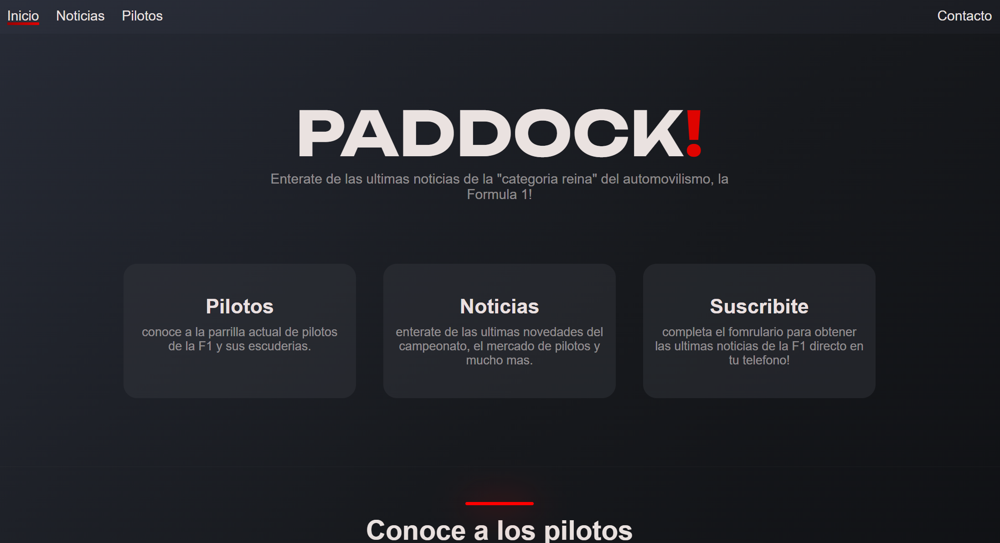

# PADDOCK!

Sitio web informativo dedicado a la Fórmula 1, que presenta los pilotos de la parrilla actual y las últimas noticias del deporte.

Proyecto desarrollado como Trabajo Final Integrador de la materia **Programación Web 1**.

## Tecnologías utilizadas

- HTML5
- CSS
- JavaScript

## Funcionalidades

- **Navegación:** menú que permite acceder a las distintas páginas del sitio e identifica la página actual.
- **Carrusel de pilotos:** carrusel circular de imágenes desarrollado con JavaScript, que permite avanzar y retroceder entre los pilotos de la parrilla actual.
- **Noticias:** sección informativa con artículos, imágenes, títulos y descripciones.
- **Formulario de suscripción - modelo:** Simula la validación de los datos ingresados mediante JavaScript y expresiones regulares, con mensajes de error y un resumen de la información cuando la validación es correcta.
- **Diseño responsive:** utilización de Flexbox y Media Queries para adaptar la interfaz a diferentes tamaños de pantalla.

## Estructura del proyecto

- `index.html`: página principal y carrusel de pilotos.
- `noticias.html`: página de noticias.
- `contacto.html`: formulario de suscripción.
- `styles.css`: estilos generales y responsive.
- `script.js`: funcionamiento del carrusel.
- `form.js`: validación y procesamiento del formulario.
- `img/`: imágenes utilizadas en el sitio.

## Ejecución

Para ejecutar y acceder al codigo completo del sitio web podes clonar el repositorio, o visitarla en el enlace que se adjunta abajo!

1. Clonar o descargar el repositorio.
2. Abrir la carpeta del proyecto.
3. Ejecutar el archivo `index.html` en un navegador web.

## Publicación

El proyecto estará disponible mediante GitHub Pages.

**Enlace:** pendiente de publicación.

## Autor

Lucas Cuello — Programación Web 1.

## Vista previa

